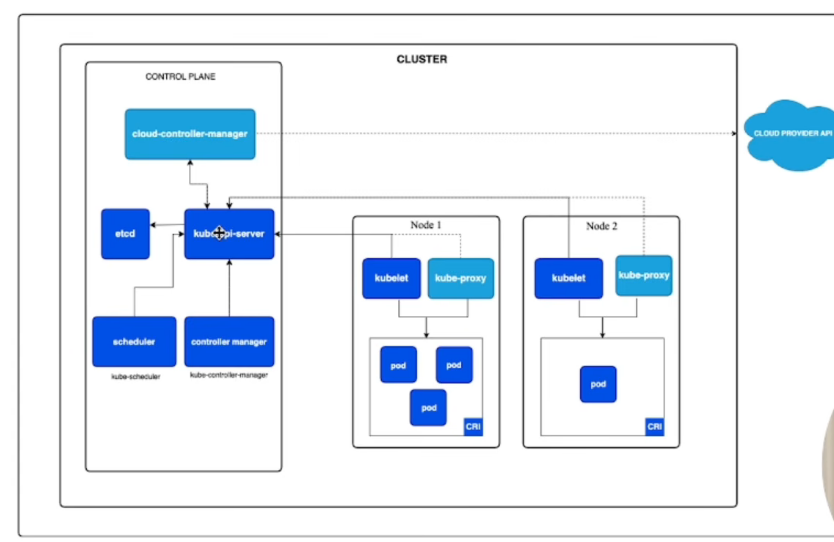
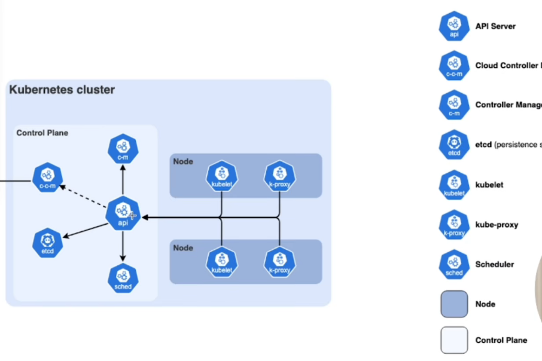

# Kubernetes – Notas de Estudo

Notas do meu estudo de Kubernetes, organizadas por tema.

## Índice

1. [Evolução do deploy](#1-evolução-do-deploy)
2. [O que é o Kubernetes](#2-o-que-é-o-kubernetes)
3. [Pods](#3-pods)
4. [Workloads](#4-workloads)
5. [Nodes e Cluster](#5-nodes-e-cluster)
6. [Arquitetura do cluster](#6-arquitetura-do-cluster)
7. [Kubernetes na AWS (EKS)](#7-kubernetes-na-aws-eks)
8. [Hands-on: comandos kubectl](#8-hands-on-comandos-kubectl)
9. [Praticar localmente com Minikube](#9-praticar-localmente-com-minikube)
10. [Namespaces](#10-namespaces)
11. [Services](#11-services)
12. [ConfigMaps e Secrets](#12-configmaps-e-secrets)
13. [Volumes e PersistentVolumes](#13-volumes-e-persistentvolumes)
14. [Rollback de Deployments](#14-rollback-de-deployments)
15. [Ingress](#15-ingress)
16. [Para estudar a seguir](#16-para-estudar-a-seguir)

---

## 1. Evolução do deploy

### Deploy tradicional

As aplicações corriam diretamente num servidor físico, sobre um único sistema operativo.

```
hardware → sistema operativo → app 1, app 2, ...
```

**Problemas:**

- Sem isolamento de recursos: se uma app consumir muito, prejudica as outras.
- Desperdício de recursos.
- A solução era comprar mais servidores, o que é muito caro.

### Máquinas virtuais (VMs)

Executam-se várias VMs no mesmo servidor físico. Cada VM tem o seu próprio sistema operativo.

```
hardware → sistema operativo → hypervisor → VM 1 { SO → bin/libs → app 1, app 2 }
                                          → VM 2 { SO → bin/libs → app 1, app 2 }
```

**Vantagens:**

- Isolamento das aplicações por VM.
- Mais segurança: os dados de uma app não podem ser acedidos por outras.
- Melhor aproveitamento dos recursos.

### Containers

Parecidos com as VMs, mas com isolamento mais flexível: **partilham o sistema operativo** do host. Por isso são muito mais leves que as VMs.

```
hardware → sistema operativo → container runtime → container 1 { bin/libs → app 1 }
                                                 → container 2 { bin/libs → app 2 }
```

| | Tradicional | VM | Container |
|---|---|---|---|
| Isolamento | Nenhum | Forte (SO próprio) | Flexível (SO partilhado) |
| Peso | – | Pesado | Leve |
| Aproveitamento de recursos | Fraco | Bom | Muito bom |

---

## 2. O que é o Kubernetes

Sistema de **código aberto** para **implantar (deploy), escalar e gerir** aplicações containerizadas, em qualquer lugar.

Simplifica a gestão de milhares de containers de forma automática: atualizações, criação de novos containers e recuperação de falhas.

O Kubernetes trabalha com **estado desejado**: nós definimos como a aplicação deve estar (por exemplo, a correr em 3 pods) e, se um falhar, o Kubernetes cria um novo para repor o estado.


high availability or no downtime
scalability or high performance
disaster recovery - backup and restore

---
Componentes of kubernetes: 
## 3. Pods

O **Pod** é a menor unidade do Kubernetes e contém um ou mais containers.

- Normalmente usa-se **1 pod com 1 container**.
- Por vezes um container depende de outro, e nesse caso colocam-se **vários containers no mesmo pod**.

como os pods comunicam entre si? cada pod tem um virtual ip. --> quandos os pods morrem, é gerado um novo com um novo ip address --> ira acontecer falhas na comunicaçao, necessario definir um ip estatico (services)

```
┌──────────── pod ────────────┐
│  ┌──────── container ─────┐ │
│  │                        │ │
│  │      nginx :80         │ │ ◄── tráfego pela porta 80
│  │                        │ │
│  └────────────────────────┘ │
└─────────────────────────────┘
```

```yaml
apiVersion: v1
kind: Pod
metadata:
  name: my-pod
spec:
  containers:
    - name: my-container
      image: nginx:latest
      ports:
        - containerPort: 80
```

> Raramente se criam pods diretamente. No dia a dia trabalha-se com centenas ou milhares de pods, e gerir cada um à mão seria o mesmo que gerir containers diretamente. Por isso usam-se **workloads**.

---


## service and ingress:
service: permanent ip address, lifecycle of pod and service are not connected, portanto se um pod morrer o service mantem se e atribuira o mesmo ip ao pod novo.

para a aplicaçao ter acesso via browser -> necessario um external service

ingress: transforma o endereço ip da pagina em algo mais seguro (https) e adiciona o dominio, por exemplo transforma http://124.89.100.22:8080 em https://my-app-luis.pt


## ConfigMap and secrets
external configuration of your application: url, username, password
  DB_URL = mongo_db_service
Dont put password on config map --> not good practise, insecure

para isso utilizamos os secrets:
secrets: usados para guardar secret data 
  a informaçao é encoded base64
use it as environment variables or as a properties file


## data storage
if a pod da database is restored, the data is gone --> problem
to do it is using a volumes --> attached a physical drive into your database
  drive could be: local(kubernetes) ou remote (outside of the k8 cluster: cloud, on premise storage)

## deployment and sttatefulset

if a containers fails, the app will be down, and the user cannot access it. so it will generates a down time.
  to solve it, you need to replicate, you need to use deployment

deployment: blueprint for my-app pods, you create deployments not pods, abstraction off pods

portanto se um pod falhar, atraves do service e do deployment, a informaçao sera reancaminhada (loadbalancer) para outro pod ativo

atençao nao podemos usar deployments para a database containers: uma vez que os databases tem states, usamos os statefulset

stateful is used for stateful apps: elastic, mongodb, mysql,...

db are often hosted outside of k8 cluster (because using stateful is not a simple operation)


## worker machine in k8 cluster

each node has multiple pods on it
3 processes must be installed on every node
worker node do the actual work

every worker need to have installed: 
container runtime - docker for example
kubelet - interacts with both the container and node, assing resources to a pod, kubelet starts the pod with a container inside
kube proxy - forwards the requests, make sure the communications works

## master nodes

4 processes that runs on every master node

API Server: cluster gateway (gets the update, query from client), acts as a gatekeeper for authentication, only 1 entrypoint into the cluster (+security)
  some request --> api server --> validates request --> other processes --> pod 

scheduler: see the resources that are need from the new pod, after that will check the workers node resources usages, and the less busy will be choice and the pod will be create on that, So the scheduler decides on which node the new pod should be scheduled
  schedule new pod --> api server --> scheduler --> where to put the pod? --> kubelet

control manager: detects cluster state changes eg: crash on pods.
  controller manager --> scheduler --> kubelet --> pod

etcd: is the cluster brain,   cluster changes get stored in the key value store
  what resoureces are available? DId the cluster state change? is the cluster healthy?
  etcd stores key values, this key values are cluster status
    aplication data is not stored in etcd

we usualy use more than one master nodes


## example cluster set up

2 master nodes  - are more important, but process less information so need less resources(cpu, ram, storage)
3 worker nodes - need more resources

if we want to add a new master/node server:
1- get new bare server
2- intastall all the master/worker node processes
3 - add it to the cluster

## minikube and kubectl

minikube - master and node processes run on one machine, is usefull to test something without needing much resources and it will be fast, and less complex than test on production
  creates a virtuall box on your laptop
  node runs in that virtual box
  testing purposes

kubectl: to interact with cluster


## minikube hands on

start cluster:
minikube start --driver=docker (na primeira vez)

apos isso usar:
minikube start
e 
minikube stop
se quisermos recomeçar tudo de novo: minikube delete e depois minikube start --driver=docker


minikube status

replicaset is managing the replicas of a pod

lfoa@lfoa-Legion-5-15ACH6H:~/Desktop/Documentacao-DevOps$ kubectl create deployment nginx-nome --image=nginx
deployment.apps/nginx-nome created
lfoa@lfoa-Legion-5-15ACH6H:~/Desktop/Documentacao-DevOps$ kubectl get pods
NAME                         READY   STATUS    RESTARTS   AGE
nginx-nome-8cdbb694f-j2hpp   1/1     Running   0          9s
lfoa@lfoa-Legion-5-15ACH6H:~/Desktop/Documentacao-DevOps$ kubectl get replicaset
NAME                   DESIRED   CURRENT   READY   AGE
nginx-nome-8cdbb694f   1         1         1       17s
lfoa@lfoa-Legion-5-15ACH6H:~/Desktop/Documentacao-DevOps$ kubectl get deployment
NAME         READY   UP-TO-DATE   AVAILABLE   AGE
nginx-nome   1/1     1            1           28s


nginx-nome            -     8cdbb694f   -   j2hpp 
nome do deployment      id do replicaset    id do pod


layers of abstraction
deployment manages a ...
replicaset manages a ...
pod manages a ...
container

kubectl exec -it nginx-nome-8cdbb694f-j2hpp -- bin/bash  --> aceder ao terminal do pod, bom para debugging


----------------------------------------------------visto 55min de video-------------------------------------


## 4. Workloads

Uma **workload** é basicamente uma **aplicação em execução**. Representa a aplicação através de um ou vários pods agrupados e geridos em conjunto.

### Recursos que gerem pods

| Recurso | Função |
|---|---|
| **ReplicaSet** | Garante um número fixo de pods (réplicas). |
| **Deployment** | Gere ReplicaSets e permite atualizar versões. **É o mais utilizado.** |
| **StatefulSet** | Para apps com estado (ex.: bases de dados). Cada pod tem identidade estável (nome fixo, ex.: `db-0`, `db-1`) e armazenamento próprio persistente. |
| **DaemonSet** | Garante que corre **1 pod em cada node** (ex.: agentes de logs e monitorização). |

---

## 5. Nodes e Cluster

### Node (nó)

Um servidor no Kubernetes chama-se **node**.

- Um node aloja vários pods.
- Cada node tem um nome **único** dentro do cluster.

```
┌────────────────── node ──────────────────┐
│   pod          pod                       │
│        pod              pod              │
└──────────────────────────────────────────┘
```

### Cluster

Conjunto de nodes que comunicam entre si. É composto por:

- **Control plane**: o "cérebro". Gere os workers e os pods.
- **Worker nodes**: onde correm as aplicações.

O control plane costuma estar distribuído por vários computadores. Se ele parar, todos os nós deixam de ser geridos, por isso é importante ter **redundância**.

---

## 6. Arquitetura do cluster





### Control plane

| Componente | Função |
|---|---|
| **kube-apiserver** | Ponto de entrada do cluster. Todos os outros componentes comunicam através dele. |
| **etcd** | Base de dados chave-valor onde fica guardado todo o estado do cluster. |
| **kube-scheduler** | Decide em que node cada novo pod vai correr. |
| **kube-controller-manager** | Corre os controladores que vigiam o estado atual e corrigem-no para o estado desejado (ex.: repor réplicas). |
| **cloud-controller-manager** | Faz a ligação à API do cloud provider (load balancers, volumes, etc.). |

### Worker node


| Componente | Função |
|---|---|
| **kubelet** | Agente do node. Comunica com o API server e garante que os containers dos pods estão a correr. |
| **kube-proxy** | Gere as regras de rede do node, para que o tráfego chegue aos pods. |
| **Container runtime (CRI)** | Software que executa os containers (ex.: containerd). |

---

## 7. Kubernetes na AWS (EKS)

Na AWS usa-se o **Amazon EKS**.

**EKS account (gerido pela AWS)**

- Instâncias do API server
- Instâncias do etcd

**Customer account (gerido por nós)**

- Add-ons do EKS: Karpenter, EKS Pod Identity, kube-proxy, CNI, EBS CSI driver, Load Balancer Controller, CoreDNS
- Instâncias EC2 (os worker nodes)
- Serviços AWS de suporte: Application Load Balancer, Network Load Balancer, volumes EBS

---

## 8. Hands-on: comandos kubectl

Formato geral:

```bash
kubectl [comando] [recurso] [nome] [flags]
```

### Alias útil

```bash
alias k=kubectl
# agora: k get pods
```

### Contexto (em que cluster estou?)

Nas empresas é comum haver vários clusters.

```bash
kubectl config current-context   # cluster atual
```

### Ver recursos

```bash
kubectl get nodes
kubectl get nodes -o wide
kubectl get pods
kubectl get pods -o wide
kubectl get rs                       # ReplicaSets
kubectl get deployment -o wide
```

### Detalhes de um recurso

```bash
kubectl describe <recurso> <nome>

kubectl describe deployment my-deployment
kubectl describe pod my-pod
kubectl describe node <nome-do-node>
```

### Criar e apagar

```bash
kubectl apply -f arquivo.yaml        # cria ou atualiza
kubectl delete pod <nome>
kubectl delete rs <nome>
kubectl delete -f arquivo.yaml
```

> Dois pods não podem ter o mesmo `metadata.name` (no mesmo namespace).

### ReplicaSet

```yaml
apiVersion: apps/v1          # atenção: apps/v1, não v1
kind: ReplicaSet
metadata:
  name: my-replicaset
  labels:
    tier: my-app
spec:
  replicas: 3                # quantos pods
  selector:                  # seleciona os pods com a label tier=my-app
    matchLabels:
      tier: my-app
  template:                  # template do pod a criar
    metadata:
      labels:
        tier: my-app
    spec:
      containers:
        - name: my-container
          image: nginx:latest
          ports:
            - containerPort: 80
```

```bash
kubectl apply -f replicaset.yaml
kubectl get rs
```

Se apagarmos um pod (`kubectl delete po <nome-do-pod>`), o ReplicaSet cria um novo automaticamente para manter as 3 réplicas.

### Deployment

O Deployment gere ReplicaSets e é essencial para **atualizar imagens** em vários pods.

```yaml
apiVersion: apps/v1
kind: Deployment
metadata:
  name: my-deployment
spec:
  replicas: 3
  selector:
    matchLabels:
      app: my-app
  template:
    metadata:
      labels:
        app: my-app
    spec:
      containers:
        - name: my-container
          image: nginx:latest
          ports:
            - containerPort: 80
```

```bash
kubectl apply -f deployment.yaml
kubectl get deployment -o wide
kubectl describe deployment my-deployment
```

**O que acontece ao atualizar a imagem e fazer `apply`?**
O Deployment cria um novo ReplicaSet com a imagem nova e vai substituindo os pods antigos pelos novos (*rolling update*). Assim a aplicação continua disponível durante a atualização.

---

## 9. Praticar localmente com Minikube

O **Minikube** cria um cluster Kubernetes na tua máquina (por defeito com 1 node que é control plane e worker ao mesmo tempo). O **kubectl** é o cliente que fala com esse cluster.

### Pré-requisito: um driver

O Minikube precisa de algo onde correr o node. O mais simples em Linux é o **Docker**:

```bash
docker --version                # confirmar que está instalado
docker ps                       # confirmar que o teu utilizador tem permissões
```

Se o `docker ps` der erro de permissões: `sudo usermod -aG docker $USER` e depois fazer logout/login.

### Verificar as instalações

```bash
kubectl version --client
minikube version
```

### Arrancar o cluster

```bash
minikube start --driver=docker
```

O `minikube start` configura automaticamente o kubectl com o contexto `minikube`. Confirma:

```bash
kubectl config current-context   # deve devolver: minikube
kubectl get nodes                # 1 node em estado Ready
minikube status
```

### Comandos úteis do Minikube

| Comando | Função |
|---|---|
| `minikube start` | Arranca o cluster (retoma o anterior, se existir) |
| `minikube stop` | Pára o cluster (mantém os dados) |
| `minikube delete` | Apaga o cluster por completo (útil para recomeçar do zero) |
| `minikube status` | Estado do cluster |
| `minikube dashboard` | Abre o dashboard web do Kubernetes |
| `minikube ip` | IP do node |
| `minikube addons list` | Lista os add-ons disponíveis |
| `minikube addons enable <nome>` | Ativa um add-on (ex.: `ingress`, `metrics-server`) |
| `minikube service <nome> --url` | Dá o URL para aceder a um Service |
| `minikube tunnel` | Expõe Services do tipo LoadBalancer (deixar a correr noutro terminal) |
| `minikube start --nodes 2` | Cria um cluster com 2 nodes (para ver scheduling de pods em vários nodes) |

### Primeiro teste

Cria um ficheiro `deployment.yaml` com o Deployment da secção 8 (`my-deployment`, 3 réplicas de nginx) e corre:

```bash
kubectl apply -f deployment.yaml
kubectl get pods -o wide
kubectl delete pod <um-dos-pods>     # ver o Deployment a recriar outro
kubectl get pods -w                  # -w (watch) acompanha em tempo real
```

> Dica: ao longo dos próximos tópicos, usa sempre este mesmo Deployment (`app: my-app`) como base. Os exemplos de Services e Ingress assumem esse label.

---

## 10. Namespaces

Os **namespaces** dividem um cluster em "espaços" lógicos isolados. Servem para separar ambientes (`dev`, `staging`, `prod`), equipas ou aplicações.

- Os nomes dos recursos só têm de ser únicos **dentro do namespace**.
- Permitem aplicar quotas de recursos e permissões por namespace.
- Nem todos os recursos pertencem a um namespace (ex.: nodes e PersistentVolumes são do cluster inteiro).

### Namespaces que já existem

| Namespace | Para quê |
|---|---|
| `default` | Onde vão parar os recursos se não indicares nenhum |
| `kube-system` | Componentes do próprio Kubernetes (api-server, coreDNS, kube-proxy, ...) |
| `kube-public` | Dados legíveis por todos (uso raro) |
| `kube-node-lease` | Heartbeats dos nodes |

### Comandos

```bash
kubectl get namespaces                        # ou: kubectl get ns
kubectl create namespace dev
kubectl get pods -n kube-system               # ver pods de um namespace
kubectl get pods -A                           # todos os namespaces
kubectl apply -f deployment.yaml -n dev       # criar recurso num namespace
kubectl delete namespace dev                  # apaga o namespace E tudo lá dentro

# mudar o namespace por defeito do contexto atual
kubectl config set-context --current --namespace=dev
```

Também se pode definir no YAML:

```yaml
metadata:
  name: my-deployment
  namespace: dev
```

> Experimenta: `kubectl get pods -n kube-system` e identifica os componentes da arquitetura da secção 6 (etcd, kube-apiserver, kube-scheduler, ...).

---

## 11. Services

Os pods são efémeros: morrem e são recriados com **IPs diferentes**. Um **Service** dá um **IP e nome DNS estáveis** a um conjunto de pods e faz load balancing entre eles.

O Service encontra os pods através de um **selector** (labels).

```
cliente ──► Service (IP fixo) ──┬──► pod 1
                                ├──► pod 2
                                └──► pod 3
```

### Tipos de Service

| Tipo | Acesso | Quando usar |
|---|---|---|
| **ClusterIP** (por defeito) | Só dentro do cluster | Comunicação entre apps (ex.: backend ↔ base de dados) |
| **NodePort** | `IP-do-node:porta` (30000–32767) | Testes e desenvolvimento |
| **LoadBalancer** | IP externo criado pelo cloud provider | Produção na cloud (na AWS cria um load balancer) |

### Exemplo (ClusterIP)

```yaml
apiVersion: v1
kind: Service
metadata:
  name: my-app-svc
spec:
  type: ClusterIP            # omitir = ClusterIP
  selector:
    app: my-app              # pods com esta label
  ports:
    - port: 80               # porta do Service
      targetPort: 80         # porta do container
```

Para NodePort basta mudar o tipo (e opcionalmente fixar a porta):

```yaml
spec:
  type: NodePort
  selector:
    app: my-app
  ports:
    - port: 80
      targetPort: 80
      nodePort: 30080
```

### Comandos

```bash
kubectl apply -f service.yaml
kubectl get svc
kubectl describe svc my-app-svc          # ver Endpoints (IPs dos pods)
kubectl get endpoints my-app-svc
```

### Aceder no Minikube

```bash
minikube service my-app-svc --url        # funciona com NodePort
```

Para um Service `LoadBalancer`, corre `minikube tunnel` noutro terminal e o `EXTERNAL-IP` deixa de ficar em `<pending>`.

### DNS interno

Dentro do cluster, qualquer pod chega ao Service pelo nome:

```
my-app-svc                                  # mesmo namespace
my-app-svc.dev                              # de outro namespace
my-app-svc.dev.svc.cluster.local            # nome completo
```

Testar:

```bash
kubectl run teste --rm -it --image=busybox -- wget -qO- http://my-app-svc
```

---

## 12. ConfigMaps e Secrets

Servem para **separar a configuração do código/imagem**, de forma a usar a mesma imagem em vários ambientes.

| | Para quê |
|---|---|
| **ConfigMap** | Configuração não sensível (URLs, flags, nível de log) |
| **Secret** | Dados sensíveis (passwords, tokens, chaves) |

> **Atenção:** um Secret está codificado em **base64**, o que **não é encriptação**. Qualquer pessoa com acesso ao Secret consegue descodificar. Em produção usa RBAC restrito, encriptação em repouso no etcd e/ou gestores externos (ex.: AWS Secrets Manager).

### ConfigMap

```yaml
apiVersion: v1
kind: ConfigMap
metadata:
  name: app-config
data:
  APP_ENV: "dev"
  LOG_LEVEL: "info"
```

### Secret

```yaml
apiVersion: v1
kind: Secret
metadata:
  name: app-secret
type: Opaque
stringData:                  # texto normal; o Kubernetes guarda em base64
  DB_PASSWORD: "minha-password"
```

### Usar num pod

**Como variáveis de ambiente:**

```yaml
spec:
  containers:
    - name: my-container
      image: nginx:latest
      envFrom:                       # todas as chaves como variáveis
        - configMapRef:
            name: app-config
      env:                           # uma chave específica
        - name: DB_PASSWORD
          valueFrom:
            secretKeyRef:
              name: app-secret
              key: DB_PASSWORD
```

**Como ficheiros (volume):**

```yaml
spec:
  containers:
    - name: my-container
      image: nginx:latest
      volumeMounts:
        - name: config-vol
          mountPath: /etc/config     # cada chave vira um ficheiro
  volumes:
    - name: config-vol
      configMap:
        name: app-config
```

### Comandos

```bash
kubectl create configmap app-config --from-literal=APP_ENV=dev
kubectl create secret generic app-secret --from-literal=DB_PASSWORD=abc123
kubectl get configmap,secret
kubectl describe configmap app-config
kubectl get secret app-secret -o yaml           # valores em base64
echo "YWJjMTIz" | base64 -d                     # descodificar
kubectl exec -it <pod> -- env                   # ver variáveis dentro do pod
```

> Nota: se alterares um ConfigMap usado como variável de ambiente, os pods **não** apanham a mudança sozinhos. É preciso recriá-los (ex.: `kubectl rollout restart deployment my-deployment`).

---

## 13. Volumes e PersistentVolumes

Os ficheiros dentro de um container **desaparecem quando o container reinicia**. Os volumes resolvem isto.

### Tipos principais

| Tipo | Ciclo de vida | Uso |
|---|---|---|
| **emptyDir** | Vive e morre com o **pod** | Partilhar ficheiros entre containers do mesmo pod, cache |
| **PersistentVolume (PV)** | Independente do pod | Dados que têm de sobreviver (bases de dados) |

### Os três conceitos de armazenamento persistente

| Recurso | O que é | Quem cria |
|---|---|---|
| **PersistentVolume (PV)** | O armazenamento real (disco EBS, NFS, pasta no host, ...) | Admin ou automaticamente pela StorageClass |
| **PersistentVolumeClaim (PVC)** | O **pedido** de armazenamento feito por uma app | Developer |
| **StorageClass** | Define *como* criar PVs automaticamente (provisionamento dinâmico) | Admin / cloud |

Fluxo: a app cria um **PVC** → a **StorageClass** cria um **PV** → o PVC liga-se ao PV → o pod monta o PVC.

No Minikube já existe uma StorageClass por defeito (`standard`), por isso basta criar o PVC:

```bash
kubectl get storageclass
```

### Exemplo: PVC + pod

```yaml
apiVersion: v1
kind: PersistentVolumeClaim
metadata:
  name: my-pvc
spec:
  accessModes:
    - ReadWriteOnce          # montado em leitura/escrita por 1 node
  resources:
    requests:
      storage: 1Gi
---
apiVersion: v1
kind: Pod
metadata:
  name: pod-com-volume
spec:
  containers:
    - name: my-container
      image: nginx:latest
      volumeMounts:
        - name: dados
          mountPath: /usr/share/nginx/html
  volumes:
    - name: dados
      persistentVolumeClaim:
        claimName: my-pvc
```

### Comandos

```bash
kubectl apply -f pvc-pod.yaml
kubectl get pvc,pv
```

### Experimento para perceber a persistência

```bash
kubectl exec pod-com-volume -- sh -c 'echo "olá" > /usr/share/nginx/html/index.html'
kubectl delete pod pod-com-volume
kubectl apply -f pvc-pod.yaml
kubectl exec pod-com-volume -- cat /usr/share/nginx/html/index.html   # o ficheiro continua lá
```

> Para bases de dados usa-se normalmente um **StatefulSet** (secção 4) com `volumeClaimTemplates`, para cada pod ter o seu próprio PVC.

---

## 14. Rollback de Deployments

Cada alteração ao template do pod num Deployment cria uma nova **revisão**. O Kubernetes guarda o histórico e permite voltar atrás.

### Fazer uma atualização

```bash
# alterar a imagem diretamente
kubectl set image deployment/my-deployment my-container=nginx:1.25

# ou editar o YAML e fazer apply
kubectl apply -f deployment.yaml
```

### Acompanhar

```bash
kubectl rollout status deployment/my-deployment
kubectl rollout history deployment/my-deployment
kubectl rollout history deployment/my-deployment --revision=2    # detalhes de uma revisão
```

Para o histórico ter uma descrição legível, anota a mudança:

```bash
kubectl annotate deployment/my-deployment kubernetes.io/change-cause="atualizar nginx para 1.25"
```

### Voltar atrás

```bash
kubectl rollout undo deployment/my-deployment                    # revisão anterior
kubectl rollout undo deployment/my-deployment --to-revision=1    # revisão específica
```

### Outros comandos úteis

```bash
kubectl rollout restart deployment/my-deployment    # recria os pods sem mudar o YAML
kubectl rollout pause deployment/my-deployment
kubectl rollout resume deployment/my-deployment
kubectl scale deployment/my-deployment --replicas=5
```

### Controlar o rolling update

```yaml
spec:
  strategy:
    type: RollingUpdate
    rollingUpdate:
      maxSurge: 1            # pods extra permitidos durante a atualização
      maxUnavailable: 0      # pods indisponíveis permitidos
```

### Experimento: simular uma atualização falhada

```bash
kubectl set image deployment/my-deployment my-container=nginx:versao-que-nao-existe
kubectl get pods                                   # novos pods em ImagePullBackOff
kubectl rollout status deployment/my-deployment    # fica à espera
kubectl rollout undo deployment/my-deployment      # repõe a versão boa
```

Repara que os pods antigos continuam a correr durante a falha, porque o rolling update só os remove quando os novos ficam prontos.

---

## 15. Ingress

Um **Service** do tipo LoadBalancer cria um load balancer externo **por serviço**, o que sai caro. O **Ingress** permite expor **vários Services por um único ponto de entrada**, com regras por domínio e caminho (HTTP/HTTPS).

```
internet ──► Ingress Controller ──┬─ app.exemplo.com/       ──► Service A ──► pods
                                  ├─ app.exemplo.com/api    ──► Service B ──► pods
                                  └─ outro.exemplo.com/     ──► Service C ──► pods
```

Há duas peças:

| Peça | O que é |
|---|---|
| **Ingress** | O recurso YAML com as regras de encaminhamento |
| **Ingress Controller** | O software que lê as regras e faz o trabalho (ex.: ingress-nginx, AWS Load Balancer Controller). **Sem controller o Ingress não faz nada.** |

> Na AWS/EKS, o **Load Balancer Controller** (que aparece nos add-ons da secção 7) cria Application Load Balancers a partir de Ingress.

### Ativar no Minikube

```bash
minikube addons enable ingress
kubectl get pods -n ingress-nginx        # esperar o controller ficar Running
```

### Exemplo

Precisa do Deployment `my-deployment` e do Service `my-app-svc` (secção 11):

```yaml
apiVersion: networking.k8s.io/v1
kind: Ingress
metadata:
  name: my-ingress
spec:
  ingressClassName: nginx
  rules:
    - host: my-app.local
      http:
        paths:
          - path: /
            pathType: Prefix
            backend:
              service:
                name: my-app-svc
                port:
                  number: 80
```

```bash
kubectl apply -f ingress.yaml
kubectl get ingress                      # esperar aparecer um ADDRESS
```

### Testar localmente

O domínio `my-app.local` não existe, por isso mapeia-o no teu `/etc/hosts`:

```bash
echo "$(minikube ip) my-app.local" | sudo tee -a /etc/hosts
curl http://my-app.local
```

Se não funcionar (acontece com o driver Docker em alguns sistemas), corre `minikube tunnel` noutro terminal e usa `127.0.0.1` no `/etc/hosts`:

```bash
echo "127.0.0.1 my-app.local" | sudo tee -a /etc/hosts
```

Alternativa sem mexer no `/etc/hosts`:

```bash
curl -H "Host: my-app.local" http://$(minikube ip)
```

---

## 16. Para estudar a seguir

- [ ] **Probes** (liveness, readiness, startup): como o Kubernetes sabe se um pod está saudável
- [ ] **Resources** (requests e limits de CPU/memória)
- [ ] **HPA** (Horizontal Pod Autoscaler): escalar pods automaticamente
- [ ] **RBAC**: permissões de utilizadores e service accounts
- [ ] **Helm**: gestor de pacotes para Kubernetes
- [ ] **Jobs e CronJobs**: tarefas pontuais e agendadas
- [ ] **Network Policies**
- [ ] **TLS no Ingress** (HTTPS)

---

## Limpar tudo no fim

```bash
kubectl delete -f .              # apaga os recursos dos YAMLs da pasta
minikube stop                    # pára o cluster
minikube delete                  # apaga o cluster completamente
```